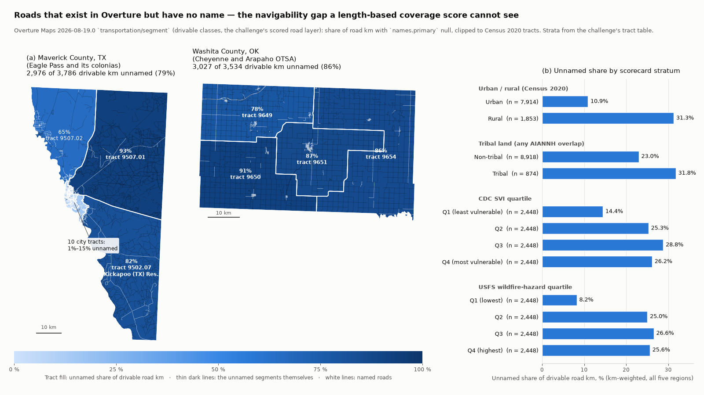

# Bias Bounty Mapping Equity Challenge — Methodology Writeup

**Zindi user `vigohan` · leaderboard submissions THErq5e9 (`blend_all5.csv`, public RMSE 0.077475) and fhLZv9UF (`blend_top3.csv`, 0.079601) · Submitted for: Best Bias Discovery (§7) and Best Documentation (§§0–5, 8) · repository `https://github.com/vigohan95/zindi-bias-bounty`**

*Entry: label-free expected-value model of the Overture coverage-gap score, plus a bias-discovery finding — phantom roads: unnamed, import-era geometry in the scored road layer. All code is open source (Python 3.11), deterministic (no random seeds are consumed; where a library accepts one it is fixed to 0), and runs on a laptop in under 25 minutes after download.*

Public repository: `https://github.com/vigohan95/zindi-bias-bounty` — `features.py`, `baseline_v1.py`, `make_submission.py`, `hypotheses.py`, `blend.py`, `blend_v2.py`, `bias_discovery.py`, `spotcheck_txdot.py`, `figure_unnamed_roads.py`, `reproduce_section7.py`, the executed notebook `writeup.ipynb` (Eastern WA end to end in about one minute, plus every Section 7 table), `bias_discovery_out.md`, `spotcheck/` (frozen TxDOT responses with `SHA256SUMS`), `figures/fig_unnamed_roads.png`, `requirements.txt`, and this file.

---

## 0. Method card

**What this entry is.** Two separable pieces. (1) A *scored submission* that predicts the organiser's `coverage_gap_score` without labels: an expected-value model built only from the challenge data (§3–4), re-centred and blended using public-leaderboard feedback (§5). (2) A *Bias Discovery* finding — phantom roads: unnamed, import-era (unedited since 2011) geometry that pads the scored road layer around the Texas border colonias — a data-source behaviour the score cannot measure, verified against a public road inventory (§7).

**Pipeline.**

```
data.source.coop bucket (Overture 2026-08-19.0 extracts, ACS, strata)        Zindi public leaderboard
        │                                                                              │
        ▼ features.py (DuckDB spatial; per-tract km / counts / strata)                  │
   features/<region>.parquet ──► baseline_v1.py (expected gap, §4) ──► pred/baseline_v1 │
        │                                 │                                            │
        │                                 ▼ hypotheses.py (6 single-signal priors) ◄── implied corr r_i (§5.1)
        │                                 ▼ blend.py / blend_v2.py (w* ∝ C⁻¹r, §5.2)
        │                                 ▼ make_submission.py (aligned to SampleSubmission.csv, checks §4.5)
        │                            submissions/blend_all5.csv, blend_top3.csv  ──► Zindi (THErq5e9, fhLZv9UF)
        ▼ bias_discovery.py (road km × names.primary × sources[].update_time < 2012 × strata) ──► §7 tables, figure_unnamed_roads.py
        ▼ spotcheck_txdot.py (6 counties × 30 unnamed + 30 named segments vs TxDOT Roadway Inventory; frozen responses + SHA256SUMS, --offline)
```

**Model assumptions (hand-set; no labels exist).**

| symbol | value | role | basis |
|---|---|---|---|
| σ_T | 0.55 | log-sd of TIGER length around its proxy | regional Overture/proxy ratios spread 0.76–1.91 (§4.1) |
| county weight | 0.5 | share of county-routed km counted as TIGER S1200 | organiser undefined-shares and ratio range (§4.1) |
| P(transport defined \| no route) | 0.03 | | 1–2 % of tracts lack named classes but TIGER is route-based |
| σ_B | 0.20 | log-sd of Microsoft footprint count around proxy | USFS/Overture per-tract ratio spread (§4.2) |
| σ_C | 0.50 | log-sd of CBP count around proxy | CBP is not published at tract level (§4.3) |
| k, ρ | 0.0243, 2.0 | establishments per resident; Overture places per establishment | national CBP/population; regional places per resident |
| u_fire, u_ems, u_school | 0.45, 0.30, 0.12 | extra reference facilities per expected Overture facility | README ordering "fire carries the component, EMS rarely binds"; schools over-counted ≈ 2:1 |
| truth moments | mean 0.060, sd 0.089 | public-subset re-centring target | two constant submissions (§5) |

**What the analysis establishes.**
- The organiser score is first of all a *rurality* signal: a pure strata prior out-scores every Overture-derived ratio on the public leaderboard (§5.1), and the best linear blend of six challenge-data signals reaches an implied correlation ≈ 0.49 with the truth (RMSE 0.0775 vs 0.089 for the best constant).
- In Overture's scored road layer, 24.7 % of drivable road km in the five regions carry no `names.primary` (263,772 of 1,069,751 km), and 78,984 km (7.4 % of all km, 29.9 % of unnamed km) is unnamed *and* unedited since 2011 — import-era geometry. Unnamed km are far more likely to be import-era than named km (TX 37.4 % vs 5.8 %; CA 35.5 % vs 4.7 %; OK 18.7 % vs 8.8 %; §7.2).
- Fifteen tracts have ≥ 50 % of their drivable km in that state ("import-era tracts"); 33,043 people live in them, 14 of the 15 tracts in the Texas border and south-west ranch counties (Maverick, Zavala, Frio, Kinney, Edwards, Jim Hogg, Dimmit, Uvalde, Sutton, Stonewall, King), 87.8 % of them in SVI deciles 8–10; at a 30 % threshold, 65 tracts and 165,593 people. A TxDOT public-road check of 180 unnamed segments in six of those counties found 163 (89.5 % of sampled km) are not public roads at all (named controls: 161/180 present and named).
- The padding is in the minor classes: only 39.9 of 192,520 km in the four scored classes (0.02 %) is unnamed-and-import-era, so the organiser's `transport_gap` is blind to it rather than inflated by it. The Oklahoma OTSA tracts are strongly unnamed (saierror's finding, cited) but not import-era: a different mechanism.

**What it does not establish.**
- *Transcription vs reality.* "Unnamed" is a property of the Overture/OSM transcription (`names.primary` null) and "import-era" an inference from edit dates (§7.5). The TxDOT check covers six Texas counties and 180 + 180 segments; it is not a five-region estimate, and no equivalent public inventory was found for Oklahoma, so the import-era km outside Texas are unverified.
- *The score itself.* No compliant entry has labels; every "implied correlation" is solved from public RMSEs on a 30 % subset (sampling sd ≈ 0.02 per value), and the scorecard ratios in §6 describe our prior, not the truth.
- *Causality.* The WLS in §7.2 is descriptive (region fixed effects, density, SVI, tribal flag); the tribal coefficient being insignificant after controls means the disparity is carried by where tribal land is, not that tribal status is irrelevant.
- *Individuals.* Strata are tract-level (SVI, any-AIANNH-overlap); statements about "people living in" a tract are ecological.

**Data provenance.** Everything from `https://data.source.coop/humane-intelligence/bias-bounty-mapping-equity-challenge/` as listed in §2, retrieved 2026-10-08 (Eastern WA added the same day), byte-size-verified against the bucket listing; Overture release 2026-08-19.0; Census 2020 tracts and strata as provided. The reference layers removed on 2026-09-25 were never downloaded (work started 2026-10-08) and no equivalent copy was used. The scored submission uses no external dataset. §7 uses two external public sources, documented with URLs, retrieval dates, licence and frozen copies in §7.4: the TxDOT Roadway Inventory (ground truth for 360 segments; not a TIGER derivative) and a Census Gazetteer county-name extract (labels only).

**Limits.** Texas is 61 % of the tracts and dominates every pooled number; two Gulf water tracts have no roads; highways whose identity lives only in `routes[].ref` are counted as unnamed in the all-classes figures (hence the residential-only figures); the figure's county outlines are the union of scored tracts; the full list of what §7 does not show is §7.5; runtime and versions are in §8.

---

## 1. Problem statement and what changed on 25 September 2026

Each scored tract receives `coverage_gap_score = mean of the defined components` among

| component | Overture side | reference side | undefined when |
|---|---|---|---|
| `transport_gap` | km of `overture-roads` with `class ∈ {motorway, trunk, primary, secondary}` | km of TIGER/Line roads, MTFCC S1100 + S1200 | tract has no TIGER highway |
| `building_gap` | count of `overture-buildings` | count of Microsoft US Building Footprints | tract has no MS footprint |
| `poi_gap` | mean of the HIFLD half (mean over defined types of fire / EMS / schools, matched on `categories.primary`) and the CBP half (all `overture-pois` vs CBP establishments) | USGS National Map facilities; CBP establishments | no facility of any type **and** no establishment |

with every ratio-gap defined as `1 − min(1, overture / reference)` (bucket README, "Format & conventions").

On 2026-09-25 the organisers removed the four reference layers from the data bucket and the rules forbid using them or equivalent copies from elsewhere. **No labels exist for a compliant entry.** This writeup therefore describes (a) a principled *prior* model that predicts the expected score from the remaining data, (b) what we learned from the public leaderboard about that prior, and (c) a bias finding that the automated scorecard cannot see.

## 2. Data sources (retrieved 2026-10-08, all public, no credentials)

Base URL `https://data.source.coop/humane-intelligence/bias-bounty-mapping-equity-challenge/` (equivalently `s3://us-west-2.opendata.source.coop/humane-intelligence/bias-bounty-mapping-equity-challenge/`). The S3 listing at the base URL enumerates 327 keys; every downloaded file was byte-size-verified against it.

Per region `R ∈ {maricopa-az, northern-ca, eastern-ok, south-central-tx, eastern-wa}`:

- `reference/R/R-overture-roads.parquet` (Overture 2026-08-19.0, `transportation/segment`, `subtype=road`, classes motorway…unclassified) — the scored road layer.
- `reference/R/R-overture-buildings.parquet` (`buildings/building`), `reference/R/R-overture-pois.parquet` (`places/place`), `reference/R/R-overture-infrastructure.parquet`, `reference/R/R-overture-rail.parquet` (the last two are read but not used by the model).
- `reference/R/R-census-acs-housing.parquet` (ACS 2020-2024 B25001 housing units).
- `reference/R/R-sample-submission.csv` — the authoritative scored tract list per region.
- `strata/R/R-strata-tract-table.parquet` (232 columns: Census 2020 population / urban-rural, CDC SVI 2022, CVI, RUCA 2020, RUCC 2023, NCHS 2013, tribal overlap, USDM / SPI / PMDI drought, EPHT / NASA / CDC heat, USFS Wildfire Risk to Communities 2nd ed., CarbonPlan, MTBS, NIFC, FPA-FOD, USGS fire, NOAA GHCN).
- `strata/R/R-census-tracts.parquet` (tract polygons, `ALAND`, `pop_total`, `ur_class`).
- `boundaries/R-tract-geoids.csv`, `boundaries/all-aois.geojson` (membership check only).
- Official Zindi `SampleSubmission.csv` (9,794 rows; columns `GEOID, coverage_gap_score, region, transport_gap, transport_defined, building_gap, building_defined, poi_gap, poi_defined, poi_gap_fire, poi_defined_fire, poi_gap_ems, poi_defined_ems, poi_gap_schools, poi_defined_schools, poi_gap_cbp, poi_defined_cbp`).

Scored tracts: TX 6,003, AZ 1,593 (incl. NM tract 35023970000), OK 1,192, CA 591, WA 415 = 9,794. No other dataset is used for the scored submission. Section 7 (Bias Discovery) computes every table from these files; its only external inputs are the TxDOT public-road inventory used for the ground-truth check and a Census Gazetteer county-name extract used for labels (§7.4).

## 3. Feature extraction (`features.py`)

DuckDB 1.5.6 with the `spatial` extension, one region at a time, all geometry in OGC:CRS84; lengths and areas by `ST_Length_Spheroid` / `ST_Area_Spheroid` after `ST_FlipCoordinates` (the README's documented axis-order pitfall). Tract polygons come from `R-census-tracts.parquet` restricted to the GEOIDs in `R-sample-submission.csv`; `GEOID` is read as text everywhere.

- **Roads.** Every segment is joined to every tract whose bbox overlaps and which `ST_Intersects`; the length inside the tract is `ST_Length` of `ST_Intersection` (or the full segment when `ST_Within`). Segments are tagged with a class group (`named` = motorway/trunk/primary/secondary, `minor` = tertiary/unclassified/residential) and a route group from `routes[].network`: `I` (`US:I`), `US` (`US:US`), `state` (`US:XX`), `county` (`US:XX:…`), `other` (forest, scenic, historic …), `none`. Output: km per tract for each class, and for each class-group × route-group cell.
- **Buildings.** Centroid-in-tract assignment. Per tract: count, count by primary source (`sources[].property = ''` → Microsoft ML Buildings / OpenStreetMap / Esri Community Maps), count with *any* Microsoft source (`bld_has_ms`; an OSM building that was conflated with a Microsoft footprint keeps the Microsoft record as a second source), footprint area.
- **Places.** Point-in-tract. Per tract: total, `permanently_closed`, confidence ≥ 0.5, and category counts using exactly the organiser's lists: fire = `fire_department`; EMS = `ambulance_and_ems_services`; schools = `elementary_school, middle_school, high_school, school, private_school, public_school`; hospitals (reported, not used).
- **Strata join.** `ALAND`, `pop_total`, `pct_urban`, `ur_class`, housing units, RUCA, RUCC, NCHS, `tribal_any`, SVI, CVI, `usfs_BuildingCount_sum`, `usfs_HUCount_sum`, `carbonplan_buildings`.

Runtime: CA 34 s, WA 28 s, OK 52 s, AZ 81 s, TX 16 min (4.4 M buildings). Output: `work/zindi/bias-bounty/features/<region>.parquet`, 57 columns.

## 4. The model (`baseline_v1.py`): expected gap under log-normal uncertainty

Because the reference quantities are unknown, each is treated as a log-normal random variable centred on a proxy computed from the provided data. For a component with Overture quantity `O`, proxy `P` and log-sd `σ`, the prediction is the **expected gap**

`E[gap] = E[max(0, 1 − e^y)]`, `y ~ N(log(O/P), σ²)` = `Φ(−x/σ) − e^{x+σ²/2} Φ(−(x+σ²)/σ)`, `x = log(O/P)`,

which is the RMSE-optimal point prediction under that belief. Definedness is likewise a probability, and the composite is `E[mean of defined components | ≥ 1 defined]`, computed exactly by enumerating the 2³ definedness patterns (and, inside POI, the 2³ facility types and the 2 halves).

### 4.1 Transport
- Overture side: `named_km` (the four classes, links included — the README states a class filter only).
- Reference proxy: TIGER S1100 + S1200 ≈ km of *any* Overture segment carrying an Interstate / US / state route ref, plus **0.5 ×** km carrying a county route ref. Evidence for this proxy, all from organiser statements: (i) the share of tracts with zero routed km is OK 21 %, CA 28–40 %, AZ 53 %, TX 19–39 % against the organisers' "≥ 1 undefined component" shares of 21 / 37 / 55 / 28 % and "over half of Maricopa has no named highway" (whereas only 1–2 % of tracts lack Overture's named *classes*); (ii) regional ratios `named_km / proxy` are OK 0.76, CA 1.55, TX 1.47, AZ 1.91 against the organisers' stated 0.71–1.59 range (Maricopa's TIGER S1200 evidently also contains unrouted arterials).
- `σ = 0.55`; `P(defined)` = 1 if routed km > 0, 0.5 if only county-routed km, 0.03 otherwise; a tract with no named km but a defined component gets gap 1.

### 4.2 Building
- Overture side: building count.
- Reference proxy: `max(usfs_BuildingCount_sum, bld_has_ms)`. The USFS Wildfire-Risk-to-Communities building count (a provided stratum, derived from Microsoft footprints at 30 m) tracks Overture counts closely (regional ratio 1.05–1.09; per-tract median 1.02; 35–40 % of tracts have Overture < USFS). `carbonplan_buildings` was rejected as a proxy because it equals the Overture count exactly (it is Overture-derived). `bld_has_ms` is a good lower bound in CA/OK/WA (ratio 1.12–1.14) but not in Phoenix (OSM import city, ratio 2.2).
- `σ = 0.20`; defined with probability 1 (0.2 if the tract has no building and no proxy).

### 4.3 POI
- **CBP half.** CBP establishment counts are not published at tract level, so the proxy is the geometric mean of a population scaling (`0.0243 × pop`, the US ratio of CBP establishments to residents) and the Overture count scaled by `ρ = 2.0` places per establishment (the regional Overture places-per-resident of 0.047–0.053 divided by 0.0243). `σ = 0.50`; defined if pop > 0 or places > 0.
- **HIFLD half.** For each type `t`, a Poisson regression (scikit-learn `PoissonRegressor`, α = 10⁻³) of the Overture count on log pop, log land area, urban share, log housing units, log places and region dummies gives `λ_t`. The number of reference facilities *not* in Overture is modelled as `K ~ Poisson(u_t λ_t)` with `u = 0.45` (fire), `0.30` (EMS), `0.12` (schools; Overture over-counts schools ≈ 2:1). If Overture has `O ≥ 1`: `gap_t = E[K/(O+K)]`, defined with probability 1. If `O = 0`: defined with probability `1 − e^{−u_t λ_t}` and gap 1 when defined. The README's note that "fire stations carry the component, EMS rarely binds" motivated the ordering of `u`.
- `poi_gap` = expected mean of the defined halves.

### 4.4 Edge cases
- **Zero-population tracts** (AZ 11, TX 14, mostly industrial/airport/water): CBP proxy uses `pop = 1`, so the CBP half reduces to the Overture-scaled term; HIFLD λ is driven by area/places. Two TX water tracts (48039990000, 48057990000) have *no* Overture roads, buildings or places; since they are on the scored list at least one component is defined and `1 − min(1, 0/ref) = 1`, so the model's 1.0 is exact by construction.
- **Water-dominated tracts and tract area.** Every area term uses `ALAND` (land area only, from `census-tracts.parquet`; the challenge files carry no `AWATER` column, so water area is never used): `features.py` sets `land_km2 = ALAND / 1e6`, and `baseline_v1.py` feeds `log(max(land_km2, 0.01))` to the Poisson regressions, so a tract's water does not raise its facility prior. Exactly two scored tracts have `ALAND = 0` (48039990000 and 48057990000, the two Gulf water tracts above); they take the 0.01 km² floor and score 1.0 by the no-feature rule. The seven other `99xx` water tracts in the Texas boundary file are not on the scored list and are never read. The transport proxy uses clipped lengths, so tract area never enters a ratio directly; huge land tracts (e.g. 40149965400, 941 km²) simply get a higher log-area prior of containing a station. In §7, density is `pop / land_km2` with `land_km2 = 0` treated as missing.
- **No-Overture-feature components** (no named-class km, no building, no place): gap 1 whenever the component is defined; P(defined) falls back to the strata-based priors. Counts among the 9,794 scored tracts: 137 have zero km in the four scored classes (OK 28, WA 5, AZ 33, CA 7, TX 64), 2 have no drivable road at all, 2 have no building and 2 have no place (the same two Gulf tracts).
- **Missing strata values.** `svi_overall` is null for 88 scored tracts and `pct_urban` for 27; the model's covariates (population, land area, urban share with null → 0, housing units, places, region) are otherwise complete, so no prediction depends on an imputed stratum. §7's WLS drops the 86 road-bearing tracts without SVI (n = 9,706); the §7 strata tables fill SVI with the median only for quartile assignment.
- **Negative or infinite logs**: Overture quantities are floored at 10⁻³ before the log; proxies at zero are set to NaN and replaced by the fallback proxy.
- **GEOID formatting**: zero-padded to 11 characters on every read and write (the Maricopa region is state FIPS 04).

### 4.5 Submission (`make_submission.py`)
Aligns predictions to the official `SampleSubmission.csv` (same 9,794 GEOIDs, same order) and asserts: no NaN, 11-digit GEOIDs, scores in [0,1], per-region counts, region label agreement, GEOID set and order equality. Output columns `GEOID, coverage_gap_score` (component columns can be added with `--components`, every cell filled).

Predicted distribution (mean / sd / p50 / p95): OK 0.106 / 0.063 / 0.093 / 0.240; AZ 0.089 / 0.045 / 0.080 / 0.171; CA 0.088 / 0.041 / 0.080 / 0.171; TX 0.084 / 0.049 / 0.073 / 0.171; WA 0.072 / 0.032 / 0.067 / 0.132. Model-implied share of tracts with ≥ 1 undefined component: OK 22 %, CA 34 %, TX 29 %, AZ 57 %, WA 24 % (organisers: 21 / 37 / 28 / 55 / –).

## 5. What the public leaderboard taught us, and alternative weightings

Public RMSE (30 % of tracts): baseline_v2 0.09213; constant 0.087 → 0.09308; constant 0.02 → 0.09752. Solving `RMSE²(c) = (c − m)² + s²` gives truth mean `m ≈ 0.060`, sd `s ≈ 0.089` on the public subset: the true score is strongly right-skewed (most tracts near zero, a tail of large gaps). From the model's own moments, `corr(pred, truth) ≈ +0.30` and the optimal linear rescale is `≈ 0.54`, giving an expected RMSE ≈ 0.085 (file `cal_k05.csv`; it scored **0.084027** on the public leaderboard, as predicted). The model is therefore informative but biased high and over-dispersed for its signal strength.

Alternative weightings and priors prepared as separate submissions (`hypotheses.py`; each affinely re-centred to mean 0.060, sd 0.045):

| file | hypothesis about where the gap lives |
|---|---|
| `cal_k05`, `cal_k10` | baseline rescaled (k = 0.5, 1.0) around 0.060 |
| `hyp_poi_only` | only the POI component carries gap (Overture ≥ reference for roads and buildings almost everywhere) |
| `hyp_undefined` | gap concentrates in tracts likely to have undefined components (fewer, noisier components; rural) |
| `hyp_osm_buildings` | building mismatch where footprints are OSM-drawn rather than Microsoft-derived |
| `hyp_rural_tribal` | pure strata prior: land area, non-urban share, tribal overlap |
| `hyp_sparse_places` | places per resident, inverted (both POI halves bind together) |

Why we did not simply weight components differently: the organiser composite is an unweighted mean of *defined* components, so any re-weighting must act through the definedness probabilities; the hypotheses above change the *location* of the gap rather than the weights.

### 5.1 Results of the hypothesis runs (public LB, 2026-10-09) and implied correlations

| file | public RMSE | implied corr with truth |
|---|---|---|
| `hyp_rural_tribal` | **0.08378** | +0.37 |
| `cal_k05` (baseline rescaled) | 0.08403 | +0.34 |
| `hyp_poi_only` | 0.09504 | +0.12 |
| `hyp_sparse_places` | 0.09793 | +0.05 |
| `hyp_undefined` | 0.10806 | −0.21 |
| `hyp_osm_buildings` | 0.11072 | −0.29 |

Correlations follow from `RMSE² = var_y + sd_p² − 2 ρ sd_p sd_y` with the truth moments of Section 5 (sampling sd ≈ 0.02 each on the 30 % subset). Three lessons: (i) a pure strata prior (land area, non-urban share, tribal overlap) carries more signal than any Overture-derived ratio — the organiser gap is first of all a rurality signal; (ii) the **Microsoft-sourced building share is positively correlated with the true gap** (+0.29): where no OpenStreetMap mapper has drawn the buildings, places, facilities and road attributes are thin too, so the OSM share is a proxy for mapping-community attention, the complement of the gap (and for the building component itself OSM-drawn areas usually hold *more* footprints than Microsoft, giving ratio > 1 and gap 0); (iii) tracts likely to have an undefined component have *smaller* true gaps (−0.21) — undefined components are dropped from the mean, and the remaining components in those (often suburban, no-highway) tracts are well covered — the opposite of the "fewer components, bigger gap" hypothesis.

### 5.2 Blending the signals (`blend.py`)

With standardized signals `s_i`, their correlation matrix `C` on the 9,794 tracts, and the implied `r_i = corr(s_i, y)`, a blend `b = Σ w_i s_i` has `corr(b, y) = wᵀr / √(wᵀCw)`, maximized by `w* ∝ C⁻¹ r` with `ρ* = √(rᵀ C⁻¹ r)`. The submission is `0.060 + ρ_blend · sd_y · b / sd_b`, clipped to [0, 1]; the expected RMSE is `sd_y √(1 − ρ²)`, and for a scale factor `c` on that optimum, `sd_y √(1 − ρ² (2c − c²))`. Signal correlations are moderate (baseline–rural/tribal 0.31, rural/tribal–Microsoft share 0.47, baseline–POI-only 0.65), so the blend gains over the best single signal.

| file | signals (weights, Σ|w| = 1) | implied ρ | expected RMSE |
|---|---|---|---|
| `blend_all5` | baseline 0.44, rural/tribal 0.13, MS share 0.12, POI-only −0.02, defined 0.29 | 0.50 | 0.0772 |
| `blend_all5_x08` / `_x125` | same, scale × 0.8 / × 1.25 | 0.50 | 0.0777 / 0.0780 |
| `blend_top3` | baseline 0.40, rural/tribal 0.39, MS share 0.21 | 0.45 | 0.0793 |
| `blend_rt_ms` | rural/tribal 0.67, MS share 0.33 (no Overture ratios at all) | 0.39 | 0.0819 |
| `rural_tribal_k037` | rural/tribal alone at its implied-optimal scale | 0.37 | 0.0827 |

The implied ρ of a blend is an in-sample upper bound (five weights fitted to five noisy correlations), so `blend_top3` is the more conservative choice and `blend_all5` the more optimistic one; the scale variants test whether the optimal-scale formula holds once clipping at 0 is applied.

## 6. Bias-scorecard reflection (scorecard returned for `cal_k05`, public RMSE 0.084027)

The scorecard's "disparity ratio" is the mean *predicted* gap in a stratum divided by the mean in its complement. Because our submission is a model of the organiser score and not the score itself, the scorecard measures **what our prior believes**, not where the truth is; it is a check on the model's assumptions, and it should be read together with the RMSE (0.084, against 0.089 for the best constant).

| stratum | disparity ratio | reading |
|---|---|---|
| Rural vs urban | **1.36×** | predicted gaps 36 % larger in rural tracts |
| Tribal vs non-tribal | **1.29×** | 29 % larger on tribal land |
| Wildfire hazard | 1.12× | modestly larger |
| High climate vulnerability (CVI) | 1.05× | similar |
| Winter drought / summer drought / summer heat | 1.02× / 0.99× / 0.97× | similar |
| High social vulnerability (SVI) | 0.94× | similar (slightly lower) |
| High hazard + high vulnerability | 0.96× | similar |

**Why the model says this.** The rural and tribal ratios come almost entirely from two terms: (i) the *definedness* of the transport component — tracts with no routed highway (53 % of Maricopa, 21–29 % elsewhere, overwhelmingly rural) average over fewer components, so the POI term dominates their composite; and (ii) the POI term itself, whose CBP half rises where Overture places per resident are low and whose HIFLD half rises where a rural tract has no `fire_department` place but a high prior of containing a station (λ grows with land area). The building term is nearly flat across strata, and the transport *ratio* term is small everywhere except Eastern Oklahoma (county-routed roads). None of the model inputs is SVI, CVI or a hazard index — the Poisson regressions use population, land area, urban share, housing units and places — so the ≈1.0 ratios on those strata are by construction, not a finding: **the model is deliberately SVI-neutral and hazard-neutral.** The 1.12× wildfire ratio is a by-product of wildfire-hazard tracts being large and rural.

**What the scorecard cannot tell us.** It cannot say whether the *true* rural/tribal disparity is 1.3× or 3×, because it is computed on our predictions; the leaderboard says only that our predictions carry ≈ 0.3 correlation with truth. The re-centring that produced `cal_k05` is affine, so it leaves every ratio ordering unchanged relative to `baseline_v2`. The one place where the scorecard and Section 7 genuinely disagree is SVI: the scorecard sees no vulnerability gradient in the *coverage* metrics, while the unnamed-road analysis finds a strong, significant SVI gradient in *usability* — which is precisely why Section 7 looks outside the five scorecard metrics.

---

## 7. Best Bias Discovery — *Phantom roads: the unreviewed 2007–08 TIGER import that pads Overture's road layer around the Texas border colonias*

**Independence.** saierror (discussion 35203, 4 October) independently reports the unnamed-road gradient on tribal land (unnamed share of `residential`/`unclassified` km × tribal × no-internet × wildfire); we cite that post rather than claim the gradient, and §7.2 reproduces it inside the scorecard's strata only as supporting evidence. What this section adds is (i) the **provenance mechanism** — the age of the unnamed kilometres, read from Overture's `sources[].update_time`; (ii) a **ground-truth check** against a public road inventory showing that most unnamed kilometres in the affected Texas counties are **not public roads at all**; (iii) the **Texas border colonia belt**, absent from the earlier post; and (iv) the **population living in the tracts the mechanism dominates**, with their vulnerability and hazard exposure. It also reports, against our own earlier draft, that the Oklahoma OTSA unnamed roads are *not* import-era geometry — a different mechanism, left to that post.

### 7.1 The pattern in one sentence
In the challenge's scored drivable-road layer, kilometres whose latest OpenStreetMap edit predates 2012 and that carry no name — in practice the 2007–08 TIGER bulk import left exactly as imported — make up 7.4 % of all road km in the five regions (78,984 of 1,069,751 km) but are concentrated in a small set of tracts along the Texas–Mexico border and the south-west Texas ranch country; a check of 180 such unnamed segments against TxDOT's inventory of every public road in Texas finds that 163 of 180 (89.5 % of the sampled unnamed kilometres) are not public roads, so the map around the Eagle Pass, Crystal City and Zapata colonias is padded with geometry that no agency maintains and that an evacuation or relief router would nonetheless drive on. A length-based coverage metric cannot see this: the padding is overwhelmingly in the minor classes the organiser's `transport_gap` ignores, so the scorecard neither penalises nor detects it.

### 7.2 Evidence (`bias_discovery.py` → `bias_discovery_out.md`; `spotcheck_txdot.py`)

**The mechanism: edit age.** Overture keeps the OpenStreetMap `update_time` of every source record. Define a segment as *import-era* when its newest `update_time` is before 2012-01-01. Unnamed km are far more likely to be import-era than named km in every region — the unnamed kilometres are, to a large extent, the kilometres nobody has looked at since the import:

| region | n tracts | road km | unnamed share | share of **unnamed** km that is import-era | share of **named** km that is import-era | unnamed-and-import-era km | as share of all km |
|---|---|---|---|---|---|---|---|
| South-Central TX | 6,001 | 576,297 | 27.4 % | **37.4 %** | 5.8 % | 59,070 | 10.2 % |
| Northern CA | 591 | 77,431 | 18.7 % | **35.5 %** | 4.7 % | 5,149 | 6.6 % |
| Eastern OK | 1,192 | 213,301 | 32.6 % | 18.7 % | 8.8 % | 12,985 | 6.1 % |
| Maricopa AZ | 1,593 | 123,557 | 12.1 % | 8.3 % | 0.5 % | 1,236 | 1.0 % |
| Eastern WA | 415 | 79,164 | 8.8 % | 7.8 % | 0.6 % | 545 | 0.7 % |

In *rural* Texas 41.1 % of unnamed km is import-era against 8.3 % of named km, and import-era unnamed geometry is 15.1 % of all rural Texas road km (rural Northern CA: 39.0 % vs 6.0 %; 8.2 % of all km). The pooled WLS below confirms the gradient survives region and density controls.

**Does the import-era geometry inflate the scored transport coverage? No — and we withdraw that earlier claim.** The organiser's `transport_gap` counts only `motorway/trunk/primary/secondary`. Of 192,520 km in those four classes, **39.9 km (0.02 %)** is unnamed-and-import-era (31.8 km of it motorway links in Texas; 150 tracts have any). The 78,944 remaining phantom-candidate km are all `tertiary/unclassified/residential`. So the scorecard's transport metric is not inflated by the padding; it is *blind* to it — which is the point: the layer the challenge ships as "the scored road layer" carries 79,000 km of unreviewed import geometry that no coverage metric in the scorecard can express, and any consumer that treats the full drivable layer as a road network (routing, length-based completeness checks, the equity scorecard's own road ratio if computed on all classes) inherits it.

**The self-constructed stratum: import-era tracts.** Call a tract *import-era* when ≥ 50 % of its drivable km is unnamed-and-import-era (sensitivity at 30 % and 70 % below). Fifteen tracts qualify; **33,043 people live in them**, 14 of the 15 in South-Central Texas and one a 88-person Tohono O'odham Nation tract in Maricopa:

| threshold | tracts | population | tribal share of that population (overall 7.3 %) | rural tracts | median SVI (overall 0.613) | people in SVI top decile | counties | road km | import-era unnamed km |
|---|---|---|---|---|---|---|---|---|---|
| ≥ 30 % | 65 | 165,593 | 12.4 % (1.7×) | 56 | 0.716 | 31,067 | 44 | 87,933 | 39,956 |
| **≥ 50 %** | **15** | **33,043** | 0.3 % | 11 | **0.811** | 7,318 | 12 | 29,550 | 17,561 |
| ≥ 70 % | 0 | — | — | — | — | — | — | — | — |

The 50 % stratum by county (tracts / people): Frio 2 / 6,323 (Pearsall–Dilley), Maverick 1 / 5,574 (east of Eagle Pass), Zavala 3 / 4,082 (Crystal City and its surroundings), Sutton 1 / 3,372, Kinney 1 / 3,129, Jim Hogg 1 / 2,746, Uvalde 1 / 2,440, Dimmit 1 / 2,357, Edwards 1 / 1,422, Stonewall 1 / 1,245, King 1 / 265, Maricopa (Tohono O'odham) 1 / 88. **87.8 % of the stratum's population lives in SVI deciles 8–10** (39.3 % of the five-region population does; decile 9 alone is over-represented 3.2×). Against the rest of South-Central Texas the 14 Texas tracts have a median SVI of 0.83 (region 0.63), a median summer Drought Severity and Coverage Index of 149 (region 85) and a median wildfire-hazard potential of 34 (region 19); summer extreme-heat days are the same (15.6 vs 15.2). The stratum is small by construction — it is where the mechanism *dominates* the map, not where it merely occurs; the ≥ 30 % row shows the same geography with 166,000 people and a 1.7× tribal over-representation.

**Within-stratum pattern (rural Texas; rural Oklahoma).** Among the 991 rural South-Central Texas tracts, the six border-belt counties named in the earlier draft (Maverick, Zapata, Brooks, Kinney, Zavala, Edwards; 6 rural tracts) have a median unnamed share of 86.2 % against 20.8 % for the other 985 rural tracts (Mann-Whitney p = 2.5 × 10⁻⁵), and a median import-era-unnamed share of **58.5 % against 1.6 %** (p = 2.5 × 10⁻⁵). Among rural Eastern Oklahoma tracts, the Cheyenne-Arapaho and Choctaw OTSA tracts (n = 79) are more unnamed than rural tracts outside any AIANNH area (n = 35): 34.3 % vs 24.1 % (p = 0.002) — but their import-era-unnamed share is only 3.2 % vs 0 % (p = 6 × 10⁻⁴): the Oklahoma unnamed roads *have* been edited since 2011 and are still unnamed, so they are not phantom import geometry (the three Washita County OTSA tracts are 88 % unnamed but only 7.8 % import-era). Rural tribal vs non-tribal within each region, unnamed share, Mann-Whitney two-sided: OK 28.1 % vs 24.1 % (n 376 / 35, p = 0.14), AZ 16.6 % vs 9.8 % (27 / 136, p = 0.005), WA 10.9 % vs 6.9 % (11 / 130, p = 0.08), CA 7.3 % vs 13.8 % (7 / 140, p = 0.88); Texas has no rural tribal tract.

**Ground truth: are the unnamed segments roads? (2026-10-14 UTC, evening of 2026-10-13 local, TxDOT Roadway Inventory, §7.4.)** For each of the six border-belt counties, the first 30 unnamed and the first 30 named drivable Overture segments by `md5(id)` inside the scored tracts were queried at their midpoint against TxDOT's inventory of every public road in Texas (state-, county- and city-maintained), 30 m radius:

| county | unnamed: in inventory | unnamed: with TxDOT name | unnamed: absent (share of sampled unnamed km) | named controls: in inventory with a name |
|---|---|---|---|---|
| Maverick | 2 / 30 | 2 | **28 / 30** (99.4 % of 24.3 km) | 29 / 30 |
| Zapata | 3 / 30 | 3 | **27 / 30** (94.1 % of 34.7 km) | 29 / 30 |
| Brooks | 2 / 30 | 2 | **28 / 30** (97.5 % of 33.1 km) | 28 / 30 |
| Kinney | 2 / 30 | 2 | **28 / 30** (91.3 % of 25.5 km) | 22 / 30 |
| Zavala | 4 / 30 | 4 | **26 / 30** (88.7 % of 33.2 km) | 29 / 30 |
| Edwards | 4 / 30 | 4 | **26 / 30** (59.6 % of 22.7 km) | 24 / 30 |
| **Pooled** | **17 / 180** | **17** | **163 / 180** (**89.5 %** of 173.5 km) | **161 / 180** |

Unnamed sample by class: residential 166, unclassified 6, secondary 4, trunk 2, motorway 1, tertiary 1; median length 697 m (named controls: 133 m). Full per-segment table: `spotcheck/spotcheck_txdot_results.csv`.

**Pooled over the six counties, 163 of the 180 unnamed segments — 89.5 % of the sampled unnamed kilometres — are absent from the inventory of public roads; 17 carry a TxDOT street name or highway id.** The named controls show the inventory and the 30 m match work: 161 of 180 (Maverick, Zapata and Zavala 29/30, Brooks 28/30; Edwards 24/30 and Kinney 22/30, the two thinnest counties, where short named ranch-road stubs fall outside the 30 m radius) are in the inventory with a TxDOT street name or highway id. Within the unnamed sample, 116 of the 180 segments are import-era and 110 of them (94.8 %) are absent; of the 64 edited since 2011, 53 (82.8 %) are absent — edit age predicts absence, but in these counties the whole unnamed class is mostly non-public. The unnamed segments that *are* public roads are county roads and highway links whose identity sits in `routes[].ref` rather than `names.primary` — a transcription gap, and a small one. Everything else is absent from the public-road inventory: private ranch and lease tracks that the 2007–08 TIGER files carried as "local roads", or geometry that no longer exists. Tract 48323950701's 1,797 km, for example, are the ranch grid east of Eagle Pass, not the colonia streets at its western edge (the ten small Eagle Pass city tracts are 1–15 % unnamed; the three large tracts around them 65–93 %).

**The same gradient is visible across the scorecard's strata, but the scorecard cannot express it.** Km-weighted shares with n tracts and km per row (from `bias_discovery_out.md` §4 and §2):

| stratum | n tracts | road km | unnamed share | unnamed-and-import-era share | median tract unnamed share |
|---|---|---|---|---|---|
| Urban | 7,914 | 348,772 | 10.9 % | 1.7 % | 4.1 % |
| Rural | 1,853 | 720,382 | **31.3 %** | **10.1 %** | 19.1 % |
| Non-tribal | 8,918 | 867,307 | 23.0 % | 7.6 % | 5.2 % |
| Tribal (any AIANNH overlap) | 874 | 202,443 | **31.8 %** | 6.3 % | 13.9 % |
| SVI quartile 1 (least vulnerable) | 2,448 | 189,717 | 14.4 % | 3.2 % | 3.8 % |
| SVI quartile 2 / 3 / 4 | 2,448 each | 344,902 / 343,091 / 192,041 | 25.3 % / 28.8 % / 26.2 % | 7.0 % / 9.2 % / 9.0 % | 6.6 % / 6.8 % / 5.9 % |
| Wildfire hazard (USFS WHP) quartile 1 → 4 | 2,448 each | 70,575 → 548,794 | 8.2 % → 25.6 % | 0.2 % → 7.7 % | 3.1 % → 9.9 % |

Note the tribal row: tribal tracts have *more* unnamed km but *less* import-era unnamed km than non-tribal tracts — the two mechanisms separate cleanly. Pooled descriptive WLS (weights = road km, region fixed effects, n = 9,706, HC1 errors): for the unnamed share, each 0.1 of SVI adds +0.86 pt (p < 0.001), each e-fold drop in density +6.3 pt (p < 0.001), tribal flag n.s. (+1.0 pt, p = 0.58), R² = 0.55; for the import-era-unnamed share, +0.36 pt per 0.1 SVI (p = 0.004), +3.9 pt per e-fold lower density (p < 0.001), tribal n.s. (p = 0.96), Texas fixed effect +6.1 pt (p < 0.001), R² = 0.38. For continuity with the earlier draft: 146 tracts have ≥ 50 % of their km unnamed (any edit age), 393,307 people live in them, 32.4 % on tribal land (4.4× the 7.3 % overall) — that figure measures saierror's gradient, not the import mechanism.



*Figure 1 — (a) Maverick County, TX (Eagle Pass and its colonias; Kickapoo (TX) Reservation) and Washita County, OK (Cheyenne and Arapaho OTSA): tract fill is the unnamed share of drivable Overture road km, thin dark lines the unnamed segments, white lines the named roads. 2,976 of Maverick's 3,786 drivable km (79 %) and 3,027 of Washita's 3,534 km (86 %) carry no name; in Maverick 46.5 % of all km is unnamed-and-import-era, in the three Washita OTSA tracts 7.8 % — the two counties illustrate the two different mechanisms. (b) Km-weighted unnamed share by scorecard stratum (n = tracts). Source: `figure_unnamed_roads.py`; data as in §7.4.*

**Named tracts (population ≥ 1,000, ≥ 20 road km), highest unnamed share, with county / AIANNH area, import-era share, SVI decile and the hazard columns from the strata table:**

| GEOID | where | class | pop | road km | unnamed | import-era unnamed | SVI (decile) | summer heat days | summer DSCI | WHP |
|---|---|---|---|---|---|---|---|---|---|---|
| 48323950701 | Maverick TX — ranch grid east of Eagle Pass; colonias at its western edge | Urban | 5,574 | 1,797 | **92.6 %** | **67.9 %** | 0.91 (10) | 15.8 | 168 | 13 |
| 40149965000 | Washita OK — Cheyenne and Arapaho OTSA | Rural | 1,989 | 897 | 91.3 % | 9.4 % | 0.52 (6) | 10.7 | 163 | 17 |
| 48427950101 | Starr TX | Rural | 1,040 | 1,156 | 88.3 % | 42.0 % | 0.78 (8) | 13.9 | 90 | 82 |
| 48271950100 | Kinney TX | Rural | 3,129 | 3,811 | 86.9 % | 56.9 % | 0.71 (8) | 15.9 | 145 | 10 |
| 40149965100 | Washita OK — Cheyenne and Arapaho OTSA | Rural | 3,409 | 641 | 86.6 % | 3.2 % | 0.55 (6) | 10.4 | 160 | 26 |
| 48137950300 | Edwards TX | Rural | 1,422 | 4,697 | 86.3 % | 60.0 % | 0.72 (8) | 15.4 | 126 | 35 |
| 40149965400 | Washita OK — Cheyenne and Arapaho OTSA | Rural | 1,750 | 1,128 | 86.2 % | 9.2 % | 0.52 (6) | 10.7 | 156 | 31 |
| 48505950402 | Zapata TX | Rural | 2,567 | 2,285 | 86.1 % | 45.7 % | 0.98 (10) | 14.9 | 136 | 48 |
| 48047950100 | Brooks TX | Rural | 2,236 | 2,052 | 85.5 % | 48.9 % | 0.91 (10) | 15.1 | 88 | 45 |
| 48247950400 | Jim Hogg TX | Rural | 2,746 | 2,550 | 84.8 % | 65.6 % | 0.81 (9) | 15.0 | 113 | 41 |
| 48127950202 | Dimmit TX | Rural | 2,357 | 1,546 | 83.7 % | 57.9 % | 0.87 (9) | 15.6 | 182 | 19 |
| 48507950301 | Zavala TX (Crystal City) | Urban | 1,744 | 1,390 | 83.1 % | 55.4 % | 0.99 (10) | 15.8 | 171 | 33 |
| 48507950200 | Zavala TX | Rural | 1,483 | 831 | 82.9 % | 60.7 % | 0.86 (9) | 15.9 | 167 | 22 |
| 48435950300 | Sutton TX | Rural | 3,372 | 3,159 | 82.6 % | 53.5 % | 0.85 (9) | 15.4 | 99 | 119 |
| 48323950207 | Maverick TX — Kickapoo (TX) Reservation | Urban | 4,614 | 1,250 | 82.0 % | 34.2 % | 0.94 (10) | 15.1 | 184 | 9 |

The ranking by unnamed *km* (area-biased towards 3,000–4,700 km ranch tracts: Edwards, Webb, Kinney, Sutton, Stonewall) and the ranking by import-era share (led by Maverick 9507.01, the two Frio County tracts around Pearsall at 66 % and 57 %, Jim Hogg, Zavala) are in `bias_discovery_out.md` §8a and §8c. Columns: CDC SVI 2022 overall percentile rank; CDC EPHT extreme-heat days per summer; US Drought Monitor summer Drought Severity and Coverage Index (0–500); USFS Wildfire Hazard Potential mean.

### 7.3 Why it matters — one checkable fact per place
The consequence is not "streets without names" (saierror's framing) but **non-existent or private tracks that the map presents as roads**, and the remediation differs accordingly: verification and deletion against county 911 centrelines, not name conflation. A relief or evacuation router that consumes Overture/OSM can route down a gated, washed-out or vanished ranch track; a coverage audit that counts kilometres awards credit for geometry no agency maintains; and in the import-era tracts the *public* streets that do exist are, as the named controls show, already named and inventoried — so the padding is the whole story there. Each fact below is a median or sum over the cluster's scored tracts from the challenge strata table (`bias_discovery_out.md` §9), so a judge can check it from the provided data.

- **Maverick County (13 tracts, 57,887 people; Eagle Pass, its colonias, the Kickapoo (TX) Reservation).** 78.6 % of the county's 3,786 drivable km is unnamed and 46.5 % is unnamed-and-import-era; the TxDOT check found 28 of 30 unnamed segments absent from the public-road inventory (99.4 % of the sampled unnamed km) against 29 of 30 named controls present and named. Median tract SVI 0.92 (regional median 0.64); median summer DSCI 173, twice the regional median of 85. The county's heat/drought relief operations and any flood evacuation of the colonias run through the two tracts with the most phantom km (9507.01: 1,797 km, 68 % import-era; 9502.07, the Reservation: 1,250 km, 34 %).
- **Zavala County (4 tracts, 9,670 people; Crystal City).** Three of the four tracts are import-era tracts (55–65 % of their km); 82.5 % of 3,082 km unnamed. Median SVI 0.87; summer DSCI 169 (regional 85). The city tract 9503.01 has SVI 0.99 — the most vulnerable percentile — and 1,390 km of road for 1,744 people, 55 % of it import-era geometry.
- **Zapata County (6 tracts, 13,889 people).** 79.6 % of 2,490 km unnamed, 42.1 % import-era; median SVI 0.95; summer DSCI 140. TxDOT check: 27 of 30 unnamed segments absent (94.1 % of km); 29 of 30 named controls present.
- **Brooks County (2 tracts, 7,076 people; Falfurrias).** 82.0 % unnamed, 46.7 % import-era; median SVI 0.90; drought exposure at the regional level (DSCI 86). TxDOT check: 28 of 30 unnamed absent (97.5 % of km); 28 of 30 controls present.
- **Kinney and Edwards Counties (one tract each; 3,129 and 1,422 people; 3,811 and 4,697 road km).** 57 % and 60 % of their km is import-era; SVI 0.71 / 0.72; Edwards has a wildfire-hazard potential of 35 against a regional median of 19. TxDOT checks: Kinney 28 of 30 unnamed absent (91.3 % of km), controls 22 of 30; Edwards 26 of 30 absent (59.6 % of km — the four public ones are long county roads), controls 24 of 30.
- **Frio County (2 import-era tracts around Pearsall, 6,323 people)** — the only *urban-class* import-era tracts outside Maverick/Zavala: 66 % and 57 % of their km is import-era, SVI 0.70 and 0.87, WHP 71 and 68 (regional 19).
- **Cheyenne and Arapaho OTSA, Washita County (3 tracts, 7,148 people) — the contrast case.** 88 % of 2,665 km unnamed but only 7.8 % import-era: these roads have been edited since 2011 and remain unnamed (Oklahoma's section-line grid, often signed only by county road numbers). Their summer DSCI is 160 against a regional median of 63 and SVI 0.52 (regional 0.62). Here the problem *is* naming/transcription, the remediation saierror describes, and a 911 or evacuation geocoder is the affected system. We did not find a free statewide public-road inventory for Oklahoma to run the same ground-truth check.

### 7.4 External data, provenance and reproducibility
- **Challenge data only** for every table in §7.2 except the TxDOT check: `reference/<region>/<region>-overture-roads.parquet` (incl. `sources[].update_time`), `strata/<region>/<region>-strata-tract-table.parquet` and `-census-tracts.parquet`, `features/<region>.parquet` from `features.py`. `PYTHONUTF8=1 python bias_discovery.py` regenerates every number in §7, including the edit-age tables, in about five minutes (output `bias_discovery_out.md`; per-tract table `features/road_attrs_joined.parquet` with `stale_km`, `unnamed_stale_km`, `unnamed_stale_scored_km` columns); `python reproduce_section7.py` runs it together with the offline spot-check and the figure. Segments whose sources carry no `update_time` (146 of 142,649 in Eastern WA, similar elsewhere) are counted as *not* import-era, which can only understate the stale share.
- **County names** in the tables come from `external/census_gaz_counties_2023_subset.csv`, a 476-row extract of the US Census Bureau 2023 Gazetteer county file (`https://www2.census.gov/geo/docs/maps-data/data/gazetteer/2023_Gazetteer/2023_Gaz_counties_national.zip`, public domain, retrieved 2026-10-13; SHA-256 of the zip, the text file and the extract in `external/SOURCES.md`). Labels only; no number depends on it.
- **TxDOT Roadway Inventory** (the only external dataset that enters a result; §7.2 ground truth; never used by the scored submission; not a TIGER/Line derivative). Feature service `https://services.arcgis.com/KTcxiTD9dsQw4r7Z/arcgis/rest/services/TxDOT_Roadway_Inventory/FeatureServer/0` (ArcGIS Online item `843ebe994c114961a855ec76ddcde086`, owner TPP_GIS, last revision 2025-08-27 per the service description), retrieved **2026-10-14 UTC, evening of 2026-10-13 local**; query per segment midpoint: `geometryType=esriGeometryPoint, inSR=4326, spatialRel=esriSpatialRelIntersects, distance=30, units=esriSRUnit_Meter, outFields=STE_NAM,HWY,HSYS,RDWAY_MAINT_AGCY,F_SYSTEM,RU,ADT_CUR,SRF_TYPE, returnGeometry=false`; requests spaced ≥ 0.5 s. Licence: the item's `licenseInfo` states "Copyright Texas Department of Transportation … provided for informational purposes only … may not be used for commercial purposes or resold. Distribution of this content to third parties without TxDOT's written consent is strictly prohibited." The portal terms page (`https://gis-txdot.opendata.arcgis.com/pages/terms-of-use`) was retrieved the same day; it is a JavaScript shell with no licence text, so the item statement is the one we cite. Full record: `spotcheck/TXDOT_SOURCE.md`.
- **Frozen responses and offline reproduction.** Every raw response (363 files: 360 segment queries plus the service and item metadata) is stored verbatim with its URL, parameters, UTC timestamp and SHA-256 under `spotcheck/txdot_responses/<county>/<segment id>.json`; the manifest `spotcheck/txdot_responses/SHA256SUMS` covers all of them (`sha256sum -c`). `PYTHONUTF8=1 python spotcheck_txdot.py --offline` verifies the manifest and rebuilds `spotcheck/spotcheck_txdot_results.csv` (one row per segment) and `spotcheck/spotcheck_txdot_summary.md` (the table above) with no network and no challenge data; without `--offline` it re-draws the same deterministic sample and re-queries the service.
- Surface (`road_surface`) and speed-limit completeness were computed as well (67 % of km lack surface, 50 % of scored-class km lack a speed limit) but vary less across strata and are omitted.

### 7.5 What this does not show
- **Ecological inference.** Strata are tract-level (SVI, any-AIANNH-overlap); "people living in import-era tracts" is a tract population, not a count of households on phantom roads.
- **One state's inventory, six counties, 30 + 30 segments each.** The ground truth is Texas only; the Oklahoma, California, Arizona and Washington import-era km are unverified. Per-county samples are small; the pooled 180/180 is the number to use, and it is a sample of segments inside the scored tracts of six specific counties, not of the five regions.
- **`names.primary` null ≠ nameless on the ground.** Highways carrying only `routes[].ref`, and roads whose names were never transcribed, are both "unnamed" here; the spot-check shows this transcription class is small in the border belt but it is exactly what the Oklahoma OTSA roads are.
- **"Import-era" is an inference from edit dates.** `update_time < 2012` means no OSM edit since 2011; the attribution to the 2007–08 TIGER import rests on the US import history and on the spot-check's finding that these segments are unnamed and largely not public roads. Sources without an `update_time` are counted as edited.
- **The WLS is descriptive**, not causal; the tribal coefficient being insignificant after region and density controls means the tribal disparity is carried by where tribal land is, not that tribal status is irrelevant.
- **Texas dominance.** Texas is 61 % of the tracts and 54 % of the road km; the 50 % stratum is almost entirely Texan. The scored-class result (0.02 %) means the finding is about the *layer*, not about a bias in the organiser's `transport_gap` numbers.
- **Not a predictor.** The unnamed share was also scored as a submission (`hyp_unnamed_roads`, implied correlation 0.22 with the truth) and adds nothing to the blend; it is reported as a bias the score cannot see, not as a feature.

---

## 8. Reproduction

```bash
# Windows / Git Bash, Python 3.11.9. Versions used: duckdb 1.5.6, pyarrow 25.0.1, pandas 3.0.3, numpy 2.4.6,
# scipy 1.17.1, scikit-learn 1.9.1, shapely 2.2.0, statsmodels 0.15.0, tabulate 0.10.0 (all open source).
# figure: matplotlib 3.11.2, geopandas 1.2.0; notebook execution: nbclient 0.11.0, ipykernel.
pip install -r requirements.txt

# 1. data (≈3.1 GB; no credentials). Edit WORK in the scripts if you use another folder.
B=https://data.source.coop/humane-intelligence/bias-bounty-mapping-equity-challenge
mkdir -p data && cd data            # or any folder; point ZINDI_WORK at it
for r in maricopa-az northern-ca eastern-ok south-central-tx eastern-wa; do
  for l in overture-roads overture-buildings overture-pois overture-infrastructure overture-rail census-acs-housing; do
    curl -sSL --retry 5 -C - --create-dirs -o reference/$r/$r-$l.parquet $B/reference/$r/$r-$l.parquet; done
  curl -sSL --retry 5 --create-dirs -o reference/$r/$r-sample-submission.csv $B/reference/$r/$r-sample-submission.csv
  for t in strata-tract-table census-tracts; do
    curl -sSL --retry 5 --create-dirs -o strata/$r/$r-$t.parquet $B/strata/$r/$r-$t.parquet; done
done
# place Zindi's SampleSubmission.csv at official/SampleSubmission.csv

# 2. features, model, submission (deterministic; total ≈ 20 min, dominated by Texas)
cd <repo folder>   # scripts live at the repository root; data folder via ZINDI_WORK (default: ./data next to the scripts)
PYTHONUTF8=1 python features.py
PYTHONUTF8=1 python baseline_v1.py
PYTHONUTF8=1 python make_submission.py baseline_v1 --out baseline_v2
PYTHONUTF8=1 python hypotheses.py          # alternative priors
PYTHONUTF8=1 python blend.py               # blend_all5 / blend_top3 (the submitted files)

# 3. Section 7 (Best Bias Discovery), one command (~5 min after the data download), or the three scripts it calls:
PYTHONUTF8=1 python reproduce_section7.py
#   = python bias_discovery.py               -> bias_discovery_out.md (every number in §7)
#   + python spotcheck_txdot.py --offline    -> verifies spotcheck/txdot_responses/SHA256SUMS, rebuilds the TxDOT table (no network)
#   + python figure_unnamed_roads.py         -> figures/fig_unnamed_roads.png
# python reproduce_section7.py --offline runs only the spot-check verification (needs neither the data nor the network);
# python spotcheck_txdot.py (without --offline) re-queries the TxDOT service at <= 2 requests/s and re-freezes the responses.
```

The Poisson regressions are convex (unique optimum); DuckDB aggregations are order-independent; no sampling is used anywhere, so repeated runs reproduce the CSVs bit-for-bit (floating-point sums over the same inputs in DuckDB's deterministic single-file scans).

### 8.1 Notebook

`writeup.ipynb` (executed outputs kept) reruns the pipeline on the Eastern WA slice — download if missing (175 MB), features, model, submission alignment and checks, the §7 extraction and edit-age query — in about one minute, and reproduces the five-region §7 tables from the cached `bias_discovery.py` output. It inlines the scripts' code, imports only open-source packages, and reports the maximum absolute difference against the cached scripted outputs (0.0 for features and for all 9,794 predictions on 2026-10-13). Run with `jupyter nbconvert --execute --to notebook --inplace writeup.ipynb` or open it in Jupyter; set `ZINDI_WORK` to the data folder (the scripts honour the same variable).

### 8.2 Integrity of the submitted files

The two files selected for the private leaderboard, with their SHA-256 digests as submitted (recomputed in the notebook):

| Zindi submission | file | public RMSE | SHA-256 |
|---|---|---|---|
| THErq5e9 | `blend_all5.csv` (9,794 rows, `GEOID,coverage_gap_score`, LF, no BOM) | 0.077475 | `8af73f9a3a253a1858e2d8487b6d8381f1b8d6e28ea8550d977fb08d6f04d325` |
| fhLZv9UF | `blend_top3.csv` (same format) | 0.079601 | `b2727e963c4eb07a75018c9c0f2b60ce363a55307bf6fe7120d0444425ca01d4` |

Run on a Windows 11 laptop (8 threads), Python 3.11.9, 2026-10-08 to 2026-10-10; full five-region pipeline ≈ 20 minutes after download.

## 9. Licences and attribution
Overture Maps (buildings/transportation ODbL; places/base CDLA-Permissive 2.0, © Overture Maps Foundation and contributors incl. OpenStreetMap), US Census (public domain), CDC SVI, USFS, and other strata as listed in the bucket README. §7 external sources: TxDOT Roadway Inventory (© Texas Department of Transportation; licence statement quoted in §7.4 and `spotcheck/TXDOT_SOURCE.md`; non-commercial verification excerpt of eight attribute fields) and the US Census Bureau 2023 Gazetteer (public domain). This writeup and code: MIT.
